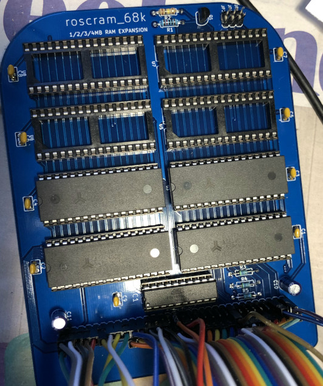

# rosco_m68k-ramboard

1–4 MB static RAM expansion for the [rosco_m68k](https://rosco-m68k.com) bus,
a maintained copy of Ross Bamford's **roscram-01** from
[rosco-m68k/hardware-projects](https://github.com/rosco-m68k/hardware-projects/tree/master/ram-expansion).
Eight AS6C4008 (512 K × 8) in DIP-32 sockets, a GAL16V8 address decoder (IC1),
three jumpers for the base address so several boards can coexist. The
schematic, logic and routing are the upstream design; this repository carries
the SolderDemon revision of the board file, kept in sync with the other
SolderDemon m68k cards.



## Changes against upstream

All changes are recorded as scripts in `tools/` and were applied in place to
`design/roscram01.kicad_pcb` with KiCad 10's Python. Re-running a script
changes nothing.

| Date | Script | Change |
|---|---|---|
| 2026-10-14 | `tools/migrate_100nf.py` | All nine 100 nF capacitors on the 5.08 mm radial footprint `SolderDemonCaps:C_Radial_5.08mm` (schematic, BOM and `fp-lib-table` follow). |
| 2026-10-14 | `tools/add_pin1_mark.py` | Filled silkscreen pointer plus `PIN 1` at pad 1 of the bus socket J1. |
| 2026-10-20 | `tools/align_capacitors.py` | Every 100 nF body on the centre line of its SRAM, C9 on the centre line of IC1, C10/C11 on that axis centred on the end pin rows of U1 and U2. The D0–D7 bend down to U1 (B.Cu) moved 1.7 mm right and D8/D9 led between the pads of C2 to make room; U2 pin 32 fed through its own via onto the bottom VCC run; the redundant F.Cu GND link from C1 to the J1 corner dropped (GND stays on both pours and the B.Cu run). Designators of the 100 nF parts inside the body outline. |
| 2026-10-20 | `tools/silk_notices.py` | Silkscreen: web link and OSHW logo removed, revision `r1`, copyright of both authors, `J1` beside `PIN 1` at 0.8 mm. |

`design/CAMOutputs` holds the upstream Gerbers and drill files of the original
revision. They do **not** reflect the changes above; regenerate them before
ordering.

## Layout

```
design/      roscram01.kicad_pcb (KiCad 10), legacy roscram01.sch (KiCad 5 format),
             fp-lib-table, sym-lib-table, BOM (roscram01.csv), upstream CAMOutputs/
code/pld/    GAL16V8 address decoder: ic1_address_decoder.pld, JEDEC, burn.sh
tools/       the scripts above; tools/capacitors/ holds the 5.08 mm footprint
             library and the replacement helper they use
```

The `rosco_m68k` footprint library referenced by `fp-lib-table` is the
upstream library (`kicad-libs/rosco_m68k.pretty`, two directories up in the
original checkout). The board embeds every footprint, so it opens and checks
without it; KiCad only notes that the library is not available.

## Checks

```sh
K="/c/Program Files/KiCad/10.0/bin"
"$K/python.exe" tools/align_capacitors.py        # prints "already aligned"
"$K/kicad-cli.exe" pcb drc --severity-error --severity-warning -o capacitor-drc.rpt design/roscram01.kicad_pcb
```

Current state (`capacitor-drc.rpt`): 0 unconnected items, 63 findings, all of
them inherited from the upstream board and unchanged by the work here (short
leftover VCC stubs on B.Cu, IC1 silkscreen over its pads, three starved
thermals on SRAM GND pins, footprint-library notes). `baseline-capacitor-drc.rpt`
is the same check on the board before the capacitor migration, for comparison.

## Licence

Open-source hardware under the **CERN Open Hardware Licence v1.2**, see
[`LICENCE.hardware.txt`](LICENCE.hardware.txt). Copyright © 2020 Ross Bamford
and Contributors; modifications © 2026 SolderDemon. The upstream notices are
kept on the board and in the schematic title block, which also carries the
modification notice required by the licence.
